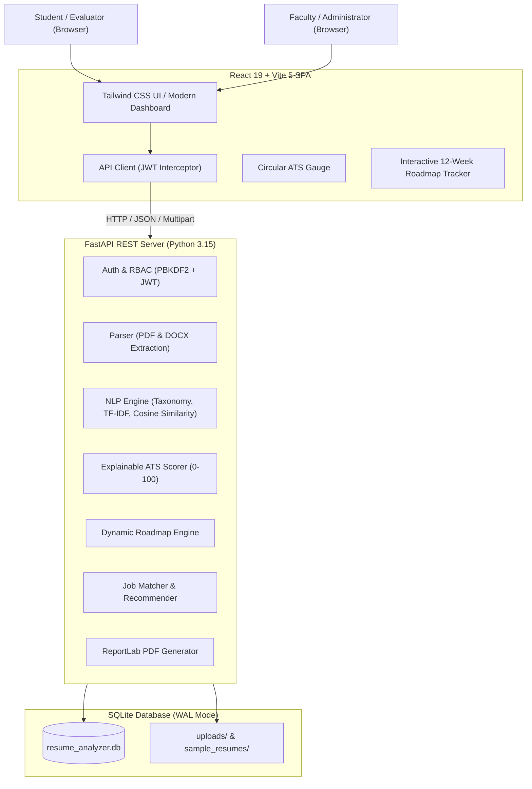

# AI Resume Analyzer and Career Roadmap Generator
**Software Engineering Laboratory Academic Project**

[](https://fastapi.tiangolo.com)
[](https://react.dev)
[](https://vitejs.dev)
[](https://tailwindcss.com)
[](https://python.org)
[]()

A complete, production-ready, full-stack web application designed for students and job seekers to analyze resumes, calculate explainable ATS compatibility scores, diagnose missing skills, benchmark against job descriptions, and generate milestone-driven personalized career roadmaps.

---

## 🌟 Key Features

1. **Secure Authentication & Role-Based Access Control (RBAC)**:
   - User registration and login using PBKDF2 cryptographic password hashing and JWT access tokens.
   - Strict privilege separation: normal users register as standard `user` accounts and **can never register as administrators**.
   - Admin-only management portal with user promotion/demotion, account deletion, system audit logging, and cohort analytics.
   - Demo fast-login buttons for both Student and Administrator profiles for immediate presentation.

2. **Multi-Format Resume Parsing (PDF & DOCX)**:
   - Robust extraction from Adobe PDF (`pypdf`) and Microsoft Word (`python-docx`).
   - File validation (format check, 10MB size limit, empty/corrupted file detection).
   - Natural Language Processing extraction of:
     * **Contact & Links**: Candidate name, email, phone, LinkedIn, GitHub, and portfolio URLs.
     * **Education**: Degree (B.Tech, B.S., M.S., Ph.D., MCA), field of study, university, year, and GPA.
     * **Technical Skills**: Programming languages, web frameworks, AI/ML, databases, cloud/DevOps, and methodologies.
     * **Soft Skills**: Leadership, communication, problem solving, teamwork, time management, adaptability.
     * **Experience & Projects**: Job titles, duration, responsibilities, bullet structure.
     * **Certifications**: Industry credentials (AWS, Azure, GCP, TensorFlow, CKA, PMP).
     * **Impact & Phrasing**: High-impact action verbs (engineered, architected, optimized) and quantifiable metrics (percentages, dollar amounts, throughput).

3. **Explainable ATS Scoring Engine (0 - 100)**:
   - **Deterministic, mathematically formulated algorithm** (no random values).
   - Category-by-category transparent breakdown across 6 distinct dimensions:
     * *Section Completeness* (20 pts)
     * *Technical & Domain Skills* (25 pts)
     * *Action Verbs & Quantifiable Impact* (20 pts)
     * *Formatting, Structure & Readability* (15 pts)
     * *Education & Certifications* (10 pts)
     * *Soft Skills & Professional Competence* (10 pts)
   - Visual circular SVG score gauge and rating tiers: Optimal (85+), Competitive (70-84), Moderate (50-69), Needs Polish (<50).
   - Lists identified strengths, bottlenecks, and prioritized recommendations with estimated score gains.
   - **Download Official PDF Report**: Exports a styled, multi-page diagnostic PDF generated via ReportLab.

4. **Job-Specific ATS Match Engine (JD Comparison)**:
   - Clearly distinguishes between general resume quality and job-specific ATS relevance.
   - Calculates **TF-IDF Semantic Cosine Similarity** and exact keyword coverage between resume and job description.
   - Identifies **matched requirements**, **critical missing requirements**, and **weakly highlighted skills**.

5. **Personalized 12-Week Career Roadmap Generator**:
   - Analyzes candidate's missing skills against a selected industry career role (Full-Stack Developer, AI/ML Engineer, Data Scientist, DevOps/Cloud, Frontend, Backend, Cybersecurity, Mobile).
   - 4-Phase Progression:
     * **Phase 1 (Weeks 1-3)**: Foundational Mastery & Core Prerequisite Filling
     * **Phase 2 (Weeks 4-7)**: Modern Frameworks & Specialized Architecture
     * **Phase 3 (Weeks 8-10)**: Capstone Portfolio Projects & Cloud Deployment
     * **Phase 4 (Weeks 11-12)**: ATS Resume Tailoring, System Design & Interview Drills
   - Interactive milestone checklist: candidates can toggle status (**To Do**, **In Progress**, **Completed**), saved directly to the database.
   - Curated links to free official documentation, video courses (freeCodeCamp, Net Ninja), and portfolio blueprints.

6. **Job & Internship Matcher**:
   - Live recommendation feed matching candidate's parsed skills against curated tech opportunities.
   - Match percentage indicator, matched skills badges, missing skills badges, salary/stipend ranges, and direct apply links.

7. **Cohort Analytics & Curriculum Insights (Admin Portal)**:
   - Cohort score distribution analytics.
   - **Top 10 Most Frequently Missing Skills** across all uploaded resumes, enabling university instructors to spot student curriculum gaps.

---

## 🏛️ System Architecture



---

## 🔬 Mathematical ATS Scoring Formula

The General ATS Compatibility Score is defined as:

$$\text{ATS Score} = \sum_{i=1}^{6} S_i$$

Where:

1. **Section Completeness ($S_1 \in [0, 20]$)**:
   - Contact Channels: Email (2.0), Phone (1.5), Full Name (1.5), Online Links (GitHub / LinkedIn / Portfolio) (3.0).
   - Core Sections: Education (2.4), Experience (2.4), Projects (2.4), Skills (2.4), Summary (2.4).
2. **Technical & Domain Skills ($S_2 \in [0, 25]$)**:
   - Skill Volume: $\min(15, \frac{\text{Tech Skills Count}}{10} \times 15)$
   - Domain Diversity: $\min(10, \text{Categories Count} \times 2.0)$ across languages, frameworks, AI/ML, databases, cloud/DevOps, and methodologies.
3. **Action Verbs & Impact Metrics ($S_3 \in [0, 20]$)**:
   - High-Impact Action Verbs: $\min(10, \frac{\text{Verbs Count}}{6} \times 10)$
   - Quantifiable Achievements (%, $, multipliers, throughput): $\min(10, \frac{\text{Metrics Count}}{3} \times 10)$
4. **Formatting, Structure & Parsability ($S_4 \in [0, 15]$)**:
   - Optimal Word Count (350 - 900 words): 8 pts (graduated penalties for <250 or >1400 words).
   - Bullet Conciseness (8 - 25 words per sentence): 4 pts.
   - Estimated Page Count (1 - 2 pages): 3 pts.
5. **Education & Credentials ($S_5 \in [0, 10]$)**:
   - Accredited Degree parsed: 6 pts.
   - GPA / Graduation timeline: 2 pts.
   - Industry Certification: 2 pts.
6. **Soft Skills & Professional Competence ($S_6 \in [0, 10]$)**:
   - Identified Behavioral & Leadership Keywords: $\min(10, \text{Soft Skills Count} \times 2.5)$.

### Job-Specific Match Formula:
$$\text{JD Match} = (0.60 \times \text{Skill Overlap}) + (0.25 \times \text{Cosine Sim}) + (0.15 \times \text{Keyword Coverage}) + \text{Bonus}_{80\%}$$

---

## 🚀 Quick Start Guide

### Prerequisites
- Python 3.10+ (tested and running on Python 3.15)
- Node.js 18+ (tested on Node v20.18)

### Running the Application
The entire application (FastAPI backend + bundled React frontend) starts with a single command:

```powershell
py run_server.py
```

Open your browser and navigate to:
- **Web Application**: `http://127.0.0.1:8000`
- **Interactive OpenAPI / Swagger Documentation**: `http://127.0.0.1:8000/docs`
- **Alternative ReDoc API Docs**: `http://127.0.0.1:8000/redoc`

---

## 🔑 Pre-Seeded Academic Demo Accounts

For instant laboratory demonstration and grading, the database comes pre-seeded with:

| Account Type | Email | Password | Access Level |
| :--- | :--- | :--- | :--- |
| **Student / Job-Seeker** | `student@resumeai.edu` | `Student@123` | Dashboard, Upload, JD Matcher, Career Roadmap, Jobs |
| **Administrator / Faculty** | `admin@resumeai.edu` | `Admin@123` | All user features + Admin Portal, Cohort Analytics, User RBAC |

*(Both accounts are accessible with one click on the Sign In page via the "Quick Laboratory Demo Profiles" buttons!)*

---

## 📂 Pre-Loaded Academic Test Resumes

Three authentic test resumes are provided in `sample_resumes/` for immediate viva testing:

1. **`Software_Engineer_Resume.pdf`**:
   - Candidate: Alexander Chen (Senior Full-Stack Developer)
   - Skills: React, TypeScript, Python, Docker, Kubernetes, AWS, PostgreSQL, Redis, Microservices.
   - **Score**: **96.0 / 100 (Optimal / ATS Ready)**.
2. **`Data_Scientist_Resume.docx`**:
   - Candidate: Priya Sharma (Data Scientist & ML Engineer)
   - Format: Microsoft Word (.docx)
   - Skills: Python, Machine Learning, Deep Learning, PyTorch, Scikit-Learn, Spark, Pandas.
   - **Score**: **97.5 / 100 (Optimal / ATS Ready)**.
3. **`Entry_Level_Student_Resume.pdf`**:
   - Candidate: Jordan Smith (Undergraduate Student)
   - Skills: Basic Python, Java, SQLite, HTML/CSS.
   - Missing: Cloud, Docker, TypeScript, React, metrics, professional links.
   - **Score**: **57.6 / 100 (Average / Needs Polish)** — Demonstrates skill-gap detection and actionable suggestions.

---

## 🧪 Running Automated Tests

Run the complete backend test suite covering parsers, ATS scoring formulas, auth tokens, and roadmap generation:

```powershell
$env:PYTHONPATH="backend"; py -m pytest backend/tests
```

**Result**: `9 passed in 0.68s` (100% pass rate).

---

## 🔌 API Endpoint Directory

### Authentication (`/api/auth`)
- `POST /api/auth/register`: Register new user account (strictly role: `user`).
- `POST /api/auth/login`: Authenticate and receive JWT token.
- `GET /api/auth/me`: Current user profile.
- `PUT /api/auth/profile`: Update user profile details.
- `POST /api/auth/change-password`: Update password.
- `POST /api/auth/forgot-password`: Password recovery workflow.

### Resume & ATS Scoring (`/api/resume`)
- `POST /api/resume/upload`: Upload PDF/DOCX, parse NLP entities, calculate ATS score, run skill gap analysis.
- `POST /api/resume/compare-jd`: Calculate TF-IDF Cosine similarity and keyword overlap with target job description.
- `GET /api/resume/history`: List user's historical resume analyses.
- `GET /api/resume/{resume_id}`: Retrieve detailed analysis for a specific resume.
- `GET /api/resume/{resume_id}/export-report`: Download official diagnostic PDF report.

### Career Roadmap (`/api/roadmap`)
- `GET /api/roadmap/roles`: Catalog of 8+ standard engineering and tech career roles.
- `GET /api/roadmap/current`: Active personalized roadmap and milestone progress.
- `POST /api/roadmap/generate`: Generate or regenerate roadmap tailored to missing skills.
- `POST /api/roadmap/milestones/{key}/status`: Update milestone status (`todo`, `in_progress`, `completed`).

### Jobs & Internships (`/api/jobs`)
- `GET /api/jobs`: List available job listings with filtering.
- `GET /api/jobs/recommendations`: Skill-matched recommendations for current candidate.
- `POST /api/jobs`: (Admin only) Post a new tech job or internship opportunity.

### Administrative Control (`/api/admin`)
- `GET /api/admin/metrics`: Cohort metrics, average ATS score, top 10 missing skills.
- `GET /api/admin/users`: List all registered users with scores and resume counts.
- `PUT /api/admin/users/{user_id}/role`: Promote or demote user role.
- `DELETE /api/admin/users/{user_id}`: Permanently remove a user account.
- `GET /api/admin/audit-logs`: View system security and action audit trail.

---

## 👥 Authors & Academic Context
Developed as the Software Engineering Laboratory Academic Project by Full-Stack & AI/ML Engineering team.
